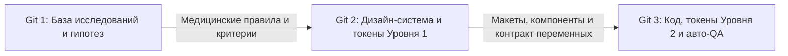

# SberZdorovie

Фронтенд по макетам Figma: онбординг, показатели здоровья, обзор пульса и статический экран помощника с анимированными переходами. Vue 3, Vite и SCSS. Структура основана на [Variant/app-new](https://github.com/heteraff1-tech/Variant/tree/main/app-new).

## Структура репозитория

```text
SberZdorovie/
├── AGENTS.md                    # Карта репозитория и обязательные guardrails
├── .github/workflows/qa.yml      # Автоматический QA в GitHub Actions
├── README.md
└── app/                         # Весь фронтенд
    ├── package.json             # Зависимости и команды
    ├── vite.config.js           # Сборка и алиас @ → src
    ├── playwright.config.js     # Браузерные проверки
    ├── public/
    │   ├── fonts/               # Локальные шрифты
    │   ├── icons/               # Отдельные пиктограммы
    │   ├── images/              # Иллюстрации и фон
    │   └── svg/                 # Графика исходного онбординга
    ├── src/
    │   ├── App.vue              # Выбор начального экрана
    │   ├── main.js              # Запуск Vue и общих стилей
    │   ├── pages/               # Сборка экранов из features
    │   ├── components/
    │   │   └── PhonePreview.vue # Корпус телефона и масштабирование
    │   ├── features/
    │   │   ├── onboarding/      # Этапы онбординга и SVG-анимация
    │   │   ├── health/          # Показатели, графики, обзор пульса
    │   │   └── assistant/       # Статичная композиция помощника
    │   ├── shared/
    │   │   ├── ui/              # Общие кнопки, иконки, штора, навигация
    │   │   ├── composables/     # Общие жесты и подписки браузера
    │   │   ├── config/          # Именованные адреса ассетов
    │   │   └── lib/             # Небольшие общие функции
    │   └── assets/styles/
    │       ├── main.scss        # Единственная точка подключения основ
    │       ├── fonts.scss       # @font-face
    │       └── tokens/
    │           ├── color.scss
    │           ├── markup.scss
    │           ├── text-style.scss
    │           └── effects.scss
    ├── tests/
    │   ├── unit/                # Жесты, токены и геометрия графиков
    │   ├── e2e/                 # Переходы, ошибки браузера и медицинский сценарий
    │   └── lib/                 # AST-анализ импортов и стилей
    └── docs/                    # Архитектура, функции и данные Figma
```

Серверная часть будет добавлена отдельно в корень репозитория. Сейчас запросов к API нет.

## Запуск

Нужен Node.js 22.12 или новее. Команды выполняются из `app/`. В PowerShell:

```powershell
cd app
npm.cmd ci
npm.cmd run dev -- --host 0.0.0.0
```

На macOS/Linux используется `npm` вместо `npm.cmd`. Для телефона в той же Wi-Fi сети открой адрес `Network`, который выведет Vite.

Адреса просмотра:

| Адрес         | Экран                               |
| ------------- | ----------------------------------- |
| `/`           | Онбординг с переходом к показателям |
| `/#home`      | Показатели здоровья                 |
| `/#pulse`     | Раскрытый обзор пульса              |
| `/#assistant` | Статический экран помощника         |

```powershell
npm.cmd run build
npm.cmd run preview -- --host 0.0.0.0
```

## Временный просмотр на телефоне

Для Xiaomi 14T открой ссылку в **Chrome** на телефоне в той же Wi-Fi сети, что и ПК. В `app/` запусти `npm.cmd run dev -- --host 0.0.0.0`. К адресу `Network`, который напечатает Vite, добавь `/?mobile=1`, например `http://192.168.1.10:5173/?mobile=1` (подставь адрес своего ПК). Мобильный режим включится с заставки Daybeat и продолжится на главной после онбординга.

- `/?mobile=1` — онбординг и переход к показателям.
- `/?mobile=1#home` — сразу главная.
- `/?mobile=1#assistant` — сразу помощник.
- `/?mobile=1#pulse` — сразу пульс.

Кнопка **«На весь экран»** доступна уже на заставке. По нажатию Chrome запросит полноэкранный режим. При успешном переходе адресная панель и кнопка исчезнут. Системная кнопка или жест **«Назад»** возвращают обычный вид браузера. При отказе показано сообщение. В браузере без Fullscreen API остаётся просмотр без рамки.

Режим убирает корпус телефона, искусственные часы, вырез iPhone и HomeBar. Ширина макета масштабируется пропорционально доступному viewport, высота подстраивается под браузерные панели и safe area. На небольшой высоте показатели прокручиваются внутри шторы. Аппаратное разрешение Xiaomi не зашито: размер в CSS зависит от настроек масштаба и браузера.

Обычное превью возвращается удалением `?mobile=1` из адреса. Для удаления функции из кода см. [инструкцию временного адаптера](app/docs/temporary-mobile.md).

## Как устроен код

- **Страницы** размещают блоки и связывают события. `HomePage` управляет фокусом и нижней навигацией.
- **`features/*/model`** содержит состояние, сценарии и расчёт данных. Здесь нет разметки экранов.
- **`features/*/ui`** отображает данные через props и сообщает о действиях через events.
- **`features/*/config`** содержит демонстрационные измерения и статичные подписи.
- **`features/*/lib`** содержит специализированный SVG-рендерер онбординга.
- **`shared/ui`** содержит общие контролы. Медицинские карточки находятся в `features/health/ui`.
- **Стили компонента** находятся в его `<style scoped lang="scss">`. Общие токены подключаются один раз в `main.scss`.

Функции имеют короткие комментарии у объявления. Полный указатель с назначением и входными данными находится в [docs/functions.md](app/docs/functions.md).

## Основные функции

| Функция / класс                                                             | Назначение                                                            |
| --------------------------------------------------------------------------- | --------------------------------------------------------------------- |
| [useHealthScreen](app/src/features/health/model/useHealthScreen.js)         | Переключает показатели, пульс и помощника; запускает графики один раз |
| [usePulseHistory](app/src/features/health/model/usePulseHistory.js)         | Рассчитывает точки истории и подписи периода                          |
| [buildWeightChart](app/src/features/health/model/weightChart.js)            | Превращает измерения веса в точки и SVG-пути                          |
| [useGlucoseScale](app/src/features/health/model/useGlucoseScale.js)         | Форматирует значение глюкозы и считает заполнение шкалы               |
| [useOnboardingFlow](app/src/features/onboarding/model/useOnboardingFlow.js) | Связывает этапы онбординга с жестом и Vue                             |
| [OnboardingFlow](app/src/features/onboarding/model/OnboardingFlow.js)       | Выполняет переходы и пружинную анимацию                               |
| [PullGesture](app/src/features/onboarding/model/PullGesture.js)             | Вычисляет расстояние, скорость и результат свайпа                     |
| [PulseShape](app/src/features/onboarding/lib/PulseShape.js)                 | Изменяет геометрию существующего SVG                                  |
| [useSwipeDismiss](app/src/shared/composables/useSwipeDismiss.js)            | Обрабатывает сворачивание шторы                                       |
| [readMotionDuration](app/src/shared/lib/motion.js)                          | Читает длительность из локального CSS экрана                          |

## Текущее поведение

Карточка пульса раскрывает ту же штору на весь экран. Назад и Escape возвращают показатели и фокус. Графики сохраняют состояние. Свет в иллюстрации пульса проходит слева направо, сердце слегка сокращается у центра; цикл длится две секунды.

Поле сообщения, значки вложения и микрофона остаются статичными; отправки, файлов, голосового ввода и истории нет. Команд выбора симптомов и медицинского ответа в интерфейсе нет. Крестик возвращает показатели здоровья, заголовок плавно меняет положение и размер в обе стороны. Значок вложения собран HTML/CSS. Композиция не следует за курсором. Переход к помощнику и возврат через нижнюю навигацию сохранены.

Демонстрационные данные находятся в `features/health/config`. При подключении API меняется источник данных в модели; компоненты получают значения через props. Apple Health, камера, добавление замера и PDF пока не подключены.

## Дизайн-система

[Актуальные макеты](https://www.figma.com/design/u0EdPHQOmvdQuc7158uN5C/Untitled?node-id=77-4755) и [переменные Figma](https://www.figma.com/design/u0EdPHQOmvdQuc7158uN5C/Untitled?node-id=250-2290) — источник цветов, скруглений и размеров текста.

В [color.scss](app/src/assets/styles/tokens/color.scss) записаны значения Light/Dark и имена из текущей Figma. [markup.scss](app/src/assets/styles/tokens/markup.scss) содержит общую шкалу и алиасы назначения по примеру `app-new`. [text-style.scss](app/src/assets/styles/tokens/text-style.scss) содержит размеры текста и готовые текстовые классы. `effects.scss` централизует оформительские эффекты и исходный брендинг онбординга, не меняя снимок Figma. Генераторов и Sass-карт токенов нет.

Параметры конкретных анимаций хранятся у их компонентов. Длительности онбординга определены в корне `OnboardingFlow.vue`; JavaScript читает их через `readMotionDuration`. При `prefers-reduced-motion: reduce` сложное движение отключается.

Подробнее: [архитектура](app/docs/architecture.md), [токены](app/docs/design-system.md), [снимок переменных](app/docs/figma-tokens.json).

## Сквозной процесс трёх репозиториев



Это схема ответственности: адреса Git 1 и Git 2 и публикации исследований не предоставлены. Межрепозиторный pipeline не подключён. Проверяемый здесь Git 3 — `SberZdorovie`; доступный источник дизайна — Figma по ссылкам выше. Уровень 1 задаёт роли и значения дизайна, Уровень 2 — прикладные алиасы размеров, эффекты и использование переменных в Vue. Изменение верхнего уровня должно сопровождаться явным обновлением снимка и проверок в коде.

Пример трассируемости одного правила:

| Этап                           | Артефакт / контракт                                                                                                                                              | Проверяемый результат                                                                                                       |
| ------------------------------ | ---------------------------------------------------------------------------------------------------------------------------------------------------------------- | --------------------------------------------------------------------------------------------------------------------------- |
| Git 1: правило HC-001          | Высокий пульс + дискомфорт **или** головокружение → предупреждение и обращение к врачу                                                                           | HC-001 — локальный ID требования этой задачи; внешняя публикация и исследовательский ID не указаны                          |
| Git 2: дизайн                  | Роли Warning, Fg, Bg и базовый Button из текущей Figma                                                                                                           | Снимок [figma-tokens.json](app/docs/figma-tokens.json) сверяется с SCSS; отдельный макет медицинской карточки пока не задан |
| Git 3: модель и UI             | [getAssistantResponse](app/src/features/assistant/model/healthcareGuardrail.js), модельный контракт для будущей интеграции                                       | Контракт предупреждения без диагноза/лечения; интерфейс команд симптомов удалён                                             |
| Git 3: автоматическая проверка | [healthcareGuardrail.test.js](app/tests/unit/healthcareGuardrail.test.js), проверка анимации и закрытия в [experience.spec.js](app/tests/e2e/experience.spec.js) | Обе комбинации проверяются в модели; E2E подтверждает отсутствие команд в UI и работу крестика                              |

## Контроль качества (QA Loop)

Направляющие — [AGENTS.md](AGENTS.md), [архитектура](app/docs/architecture.md), [дизайн-система](app/docs/design-system.md) и [контракты функций](app/docs/functions.md). Они объясняют, где менять код, как переиспользовать UI и какое поведение сохранить. Вычислительные и браузерные датчики проверяют выполнение этих правил командой `npm run qa`.

```text
Задача → AGENTS.md + app/docs/* → правка → npm run qa
                                           │
                               unit → build → Playwright
                                           │
                           ошибка → стектрейс/trace → исправление
                                           │
                                 повтор полного QA → зелёный результат
```

После любой правки кода агент обязан повторить полный QA. Падающий тест, сборка, `console.error` или `pageerror` останавливает цикл. Запрещено скрывать ошибки, отключать проверки или молча перезаписывать визуальные эталоны. В текущем наборе нет screenshot-baselines; этот запрет относится и к их будущему добавлению.

| Датчик                                | Что контролирует                                                                                                                                 |
| ------------------------------------- | ------------------------------------------------------------------------------------------------------------------------------------------------ |
| `architecture.test.js`                | Все исходники shared, включая Vue/SCSS; запрещённые alias/relative/dynamic imports, направление слоёв и публичный index feature                  |
| `no-hardcode.test.js`                 | HEX/RGB в SCSS, Vue-стилях, inline-стилях и script; margin/padding/gap только из общих токенов, с файлом, строкой и подсказкой                   |
| `tokens.test.js`                      | Точное соответствие обеих тем снимку Figma, разрешимость переменных и компактная шкала spacing                                                   |
| `healthcareGuardrail.test.js`         | Условие HC-001, дисклеймер, отсутствие полей диагноза/лечения и явный контакт                                                                    |
| `experience.spec.js`, `pulse.spec.js` | 375×812 и 360×740, отсутствие ошибок JS/консоли и горизонтального overflow, переходы и живое переключение reduced motion у BerryPulse/PulseHeart |
| `sensors.spec.js`                     | Самопроверка датчиков на изолированной странице с намеренными JS/console-ошибками и переполнением                                                |

Playwright всегда запускает свежий preview после production build; занятый порт 4173 завершает прогон ошибкой, а не подменяет проверяемую сборку. Датчики ошибок подключаются до первого перехода. GitHub Actions запускает ту же команду на PR и push в `main`/`codex/**`; при сбое сохраняет trace в артефактах. Для локальной диагностики: `npx.cmd playwright show-trace test-results/<сценарий>/trace.zip`.

Ролевое разделение в процессе:

- **Codex** — архитектура, логика, контракты, тесты и исправление их причин.
- **Gemini** — физика анимаций и UX-ревью; замечания превращаются в конкретные критерии проверки. Автотесты не заменяют визуальное ревью. Этот прогон выполнен Codex, участие Gemini не имитируется.

Примеры уже выявленных и исправленных дефектов:

1. Первый прогон нового Harness нашёл 52 нарушения стилей в 12 файлах: например, HEX в `HomePage` и RGB-кромку `SuggestionCard`. Цвета и оформительские эффекты централизованы в tokens; обычные отступы используют общую шкалу.
2. Проверка отступов выявила `margin-left: -7.5px` в `WeightCard`. Убрана компенсация: модель и SVG теперь используют одну область 318 px без бокового отрицательного margin.
3. При переключении помощника заголовок заменялся другим DOM-узлом, из-за чего CSS-переход обрывался. Заголовок теперь постоянный; браузерный тест проверяет промежуточные размер и положение в обе стороны, закрытие крестиком и возврат фокуса.

## Запуск проверок

Из `app/`:

```powershell
npm.cmd run qa
npm.cmd run format:check
```

Для браузерных тестов один раз установи Chromium: `npx.cmd playwright install chromium`. Если Chromium уже установлен, можно указать его путь переменной `PLAYWRIGHT_CHROMIUM_EXECUTABLE_PATH`.

Форматирование всего фронтенда и корневого README: `npm.cmd run format`.
